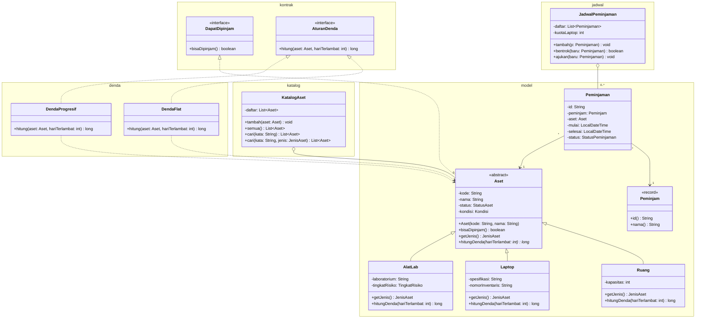

# Class Diagram Aset-Pinjam (minggu 6)

- Kelas hasil kerja minggu 1-5 digambar lengkap: `Aset`, `Ruang`, `Laptop`, `AlatLab`, `KatalogAset`,
  `DendaFlat`, `DendaProgresif`, dan interface `DapatDipinjam` serta `AturanDenda`.
- `Peminjam`, `Peminjaman`, dan `JadwalPeminjaman` adalah kerangka dari dosen. Hanya anggota yang
  dipakai Sequence Diagram pengajuan yang digambar. `bentrok()` dan `ajukan()` masih `TODO` (minggu 7 dan 9).
- Getter sederhana tidak digambar, dan enum dituliskan sebagai tipe atribut.

Notasi: `+` public, `-` private, `#` protected, `*` abstract.

## Catatan

- **Ada di kode tetapi tidak digambar** (kerangka minggu 7-11 atau pendukung): enum (`StatusAset`, `Kondisi`,
  `JenisAset`, `TingkatRisiko`, `StatusPeminjaman`), `Varian`, `LayananDenda`, paket `dao`, paket `exception`,
  dan `AsetFactory`.
- **Aggregation:** `KatalogAset o-- Aset` dan `JadwalPeminjaman o-- Peminjaman`, karena objek dibuat di luar
  lalu dimasukkan lewat `tambah(...)` dan tetap hidup tanpa wadahnya.
- **Composition:** belum ada di kode saat ini, jadi tidak digambar.
- **Dependency** ke `Varian`: `Ruang`, `Laptop`, dan `AlatLab` memanggil `Varian.aktif()` di `hitungDenda`.
