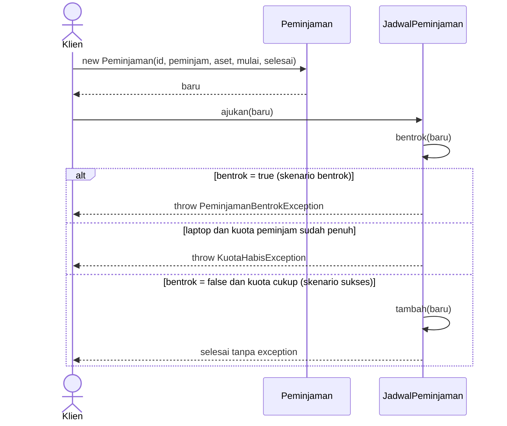

# Sequence Diagram: Pengajuan Peminjaman

Alur: klien membuat `Peminjaman`, lalu memanggil `JadwalPeminjaman.ajukan(baru)`.

## Skenario sukses dan skenario bentrok (fragmen `alt`)

## Penjelasan

| Skenario | Kondisi | Hasil |
|---|---|---|
| Sukses | Tidak bentrok pada aset yang sama dan kuota laptop belum habis | `baru` ditambahkan ke daftar jadwal |
| Bentrok | Rentang waktu tumpang tindih pada aset yang sama | `PeminjamanBentrokException` |
| Kuota habis (tambahan) | Peminjam sudah memegang `kuotaLaptop` laptop aktif dan mengajukan laptop lagi | `KuotaHabisException` |

Definisi bentrok di batas waktu (11:00 vs 11:00) adalah keputusan di `docs/asumsi.md`.
